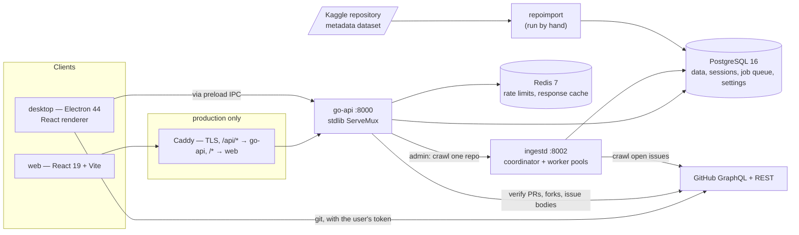

# Architecture

How SkillIssues is put together, as of the code in this repository. For the rules contributors
must follow, see [CLAUDE.md](CLAUDE.md); for running it in production, [DEPLOYMENT.md](DEPLOYMENT.md).

## 1. Components



| Binary (`backend/cmd/`) | Role |
|---|---|
| `api` | The HTTP API ([route list](docs/api.md)). Go standard-library `http.ServeMux` with method patterns; no third-party router. |
| `ingestd` | GitHub crawler. One coordinator loop plus two worker pools (Initial, Deep Diver). Uses Postgres only — not Redis. |
| `migrate` | Applies the embedded goose migrations and exits. Compose runs it before anything else starts. |
| `repoimport` | Streams the ~4.2M-record Kaggle dataset, stores the ~288k eligible repositories. Resumable, idempotent. |
| `healthcheck` | Tiny binary used as the containers' Docker `HEALTHCHECK`. |

The schema lives only in `backend/internal/migrate/migrations/`, embedded into the binaries.

## 2. Ingestion

```text
Kaggle dataset ──repoimport──▶ repositories (eligible only)
                                   │ coordinator, every 5s
                                   ▼
                     Initial: first page of open issues
                                   │ hasNextPage?
                                   ▼
                     Deep Diver: next page from stored cursor, until done
                                   │
                     Freshness: re-fetch page one once the last sync is stale
```

- **Every eligible repository is crawled.** There is no ranking or priority anywhere in the
  crawl path: jobs are FIFO on `next_retry_at`. Eligibility (`ingest.eligibility.*`) is abuse
  control — anyone can open issues on a throwaway repo — not a quality judgement.
- **Postgres is the queue.** `ingest_jobs` rows are claimed with `FOR UPDATE SKIP LOCKED` and a
  lease. A page's issues, its cursor and `last_synced_at` commit in one transaction, so a crash
  can only cause a page to be fetched twice, never skipped.
- **One shared GitHub budget.** Both lanes (`crawler`, `interactive`) record GitHub's rate-limit
  telemetry in `github_budget`; the crawler stops below `ingest.rate_limit_floor`.
- **Failures are isolated.** `NOT_FOUND` marks the repository unavailable;
  `RESOURCE_LIMITS_EXCEEDED` halves the page size and retries down to 1; rate limits pause the
  lane for a minute; other errors back off exponentially and land in `failed` after
  `ingest.max_attempts`.
- **Disk guardrails.** `ingest.max_pages_per_repo` caps how deep one repository goes;
  `ingest.max_db_size_mb` pauses new work when the database grows past it.

Design rationale and what is not built yet (the Discovery Sweeper): [docs/ingestion-architecture.md](docs/ingestion-architecture.md).

## 3. Data model (main tables)

| Table | Holds |
|---|---|
| `repositories` | Imported metadata: stars, language, topics, pushed date, `is_eligible`, `last_synced_at` |
| `issues` | One row per `(repository_id, number)`; raw GitHub `labels` kept as-is; `updated_at` is GitHub's |
| `issue_body_cache` | Bounded LRU of issue bodies, fetched on demand (bodies are not crawled) |
| `users`, `auth_sessions` | Accounts; sessions stored as SHA-256 hashes of the cookie token |
| `developer_profiles`, `developer_preferences` | XP, level, badges; languages, interests, target level |
| `contributions`, `contribution_audit_log` | One attempt at an issue and its state history |
| `saved_issues` | Bookmarks |
| `ingest_jobs`, `github_budget`, `import_skipped` | Crawl queue, shared rate-limit budget, import skip ledger |
| `settings`, `settings_audit` | Live configuration and every change to it |
| `webhook_events` | GitHub delivery ids, for deduplication |

## 4. How the product logic works

**Difficulty** (`internal/sync/classify.go`) comes from labels only. Beginner-style labels
(`good first issue`, `difficulty/easy`, `size/xs`, `effort/low`, …) → `BEGINNER`; medium →
`INTERMEDIATE`; hard/expert/large → `ADVANCED`. Anything else is `UNCLASSIFIED` with a NULL
score. There is no text or comment-count heuristic.

**Search** (`internal/issue/search.go`). Each match is put in one category — Repository, Title
(Postgres full-text), Language (language, technologies, tags, skills) or Author — and a
`ROW_NUMBER() OVER (PARTITION BY category)` CTE keeps at most `api.search.per_category_cap`
results per category, so one category cannot flood the page.

**Recommendations** (`internal/recommendation/score.go`):
`15 × language match + 8 × technology match + 2 × shared skills + shared interests +
max(0, 5 − |difficulty − target|) + min(3, stars / 25000 + 1)`.

**Progression** (`internal/progression/xp.go`). XP is awarded once, only after GitHub reports
the PR merged *and* its author matches the user — via `POST /contributions/{id}/verify` or the
`pull_request` webhook. Base 75 / 140 / 250 by difficulty (an `UNCLASSIFIED` issue counts as
75), plus 25 for the merge, 15 for a first or second merge in that repository, 10 for an issue
spanning several skills or technologies. Level *n*+1 costs 150 + 150·*n* XP more than level
*n* (300, 750, 1350, 2100, …). Badges are recomputed from merge, repository and language counts.

## 5. Auth and credentials

- **Login** is GitHub OAuth App or GitHub App, through the browser; the desktop app polls
  `/auth/github/poll` until the browser flow completes. PAT login exists but is off
  (`auth.pat_login_enabled`).
- **Sessions** live in Postgres, so they survive a Redis outage. The cookie is `HttpOnly`;
  always `SameSite=Lax`, and `Secure` when `FRONTEND_URL` is `https://`.
- **Accounts link** by GitHub id or case-insensitive username, so OAuth and PAT logins are one
  user.
- **Whose token does what:** crawling and on-demand reads use the server credential (GitHub App
  installation token, or `GITHUB_TOKEN`). Forks, pushes and PRs use **the user's own**
  authorization and never fall back to the server's — that would attribute their contribution to
  the server. User tokens are encrypted at rest with `TOKEN_ENCRYPTION_KEY`.
- **Webhooks** are HMAC-SHA256 verified. **Admin** routes take a bearer token compared in
  constant time.

## 6. Rate limiting and caching

A Redis counter per signed-in user or per client IP (`X-Forwarded-For` honoured only from
`TRUSTED_PROXIES`). Defaults are 180 requests per window signed out and 1,000 signed in, window
3600s — all live settings. The window is fixed: it starts at a client's first request and the
count resets one window later, however busy the client is. `/health`, `/health/detail` and `/metrics` are exempt;
login is not. Redis also caches the default catalog page, unauthenticated searches and
recommendations. If Redis is down, limiting fails open and caching is skipped — nothing else
depends on it. Each failed Redis call counts in `cache_errors_total{op}`, and the API logs once
when Redis becomes unreachable and once when it recovers.

## 7. Configuration

Three layers: bootstrap env (`DATABASE_URL`, `REDIS_URL`, `PORT`, `FRONTEND_URL`), secrets in
env, and **everything operational in the `settings` table**, changeable live and validated by a
database trigger. Full list: [docs/settings.md](docs/settings.md).

## 8. Observability

Both Go services serve Prometheus metrics at `/metrics`: HTTP traffic and latency by route
pattern, outbound GitHub calls, ingest job outcomes, queue depth, repository coverage, the GitHub
budget per lane, worker pools, connection pools, and Go runtime stats. The compose stacks run
Prometheus, Grafana (six provisioned dashboards), node-exporter, cAdvisor and Postgres/Redis
exporters. Product panels query Postgres as `metrics_ro`, a read-only role that cannot see token
columns. See DEPLOYMENT.md → *Monitoring*.

## 9. Clients

Both clients share three npm workspace packages: `@skillissues/api-client` (typed client,
`ApiError` with status and detail, pluggable fetch or IPC transport), `@skillissues/ui` (Modal
with focus trap and scroll lock, issue and contribution lists, …) and `@skillissues/markdown`
(markdown-it + DOMPurify — issue bodies are attacker-controlled).

**Web** (`web/`): React 19 single-page app. Signed-out visitors get `LandingPage`; signed-in
users get the catalog.

**Desktop** (`desktop/`, electron-vite): the renderer runs with `contextIsolation`, `sandbox`
and no Node integration, behind a Content Security Policy, and reaches the API only through the
preload bridge. The main process holds a single-instance lock, opens only allow-listed GitHub
URLs, and registers the `skillissues://` protocol. Workspace flow: fork with the user's token,
clone into the chosen workspace folder (default `~/Documents/SkillIssues`; git commands refuse
to run outside it), point `origin` at the fork and `upstream` at the original, create a branch,
push, open VS Code. Git runs as async child processes and every command is logged to
`.skillissues/commands.log` in the clone. Cloned code is never executed.
