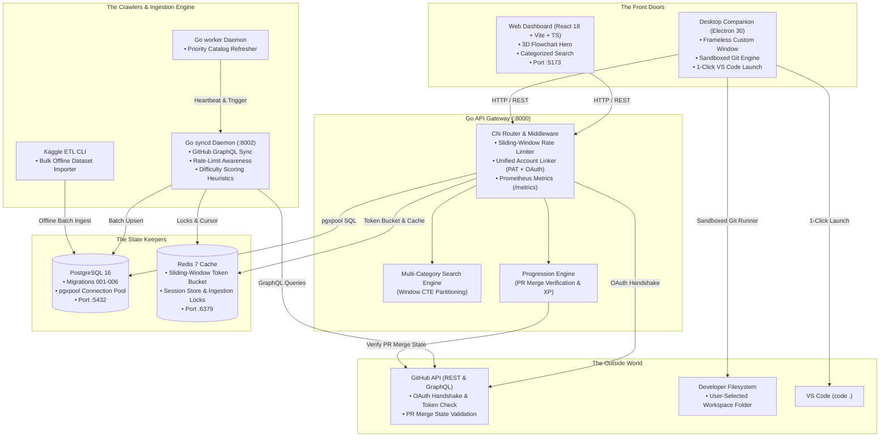
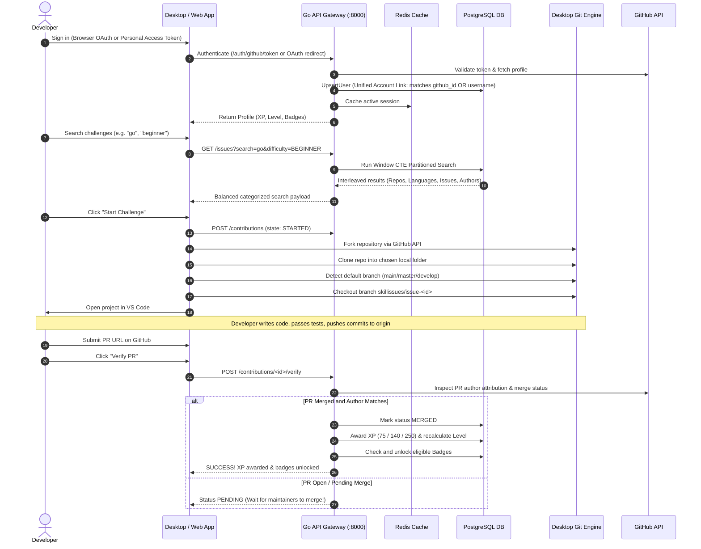

# SkillIssues — Architecture & Under the Hood

> **How we turned GitHub's overwhelming issue pile into a curated, verified questline without catching on fire.**

---

## 1. The High-Altitude View

SkillIssues is designed to solve a simple problem: **GitHub has infinite open issues, but almost no signal on what you should actually work on next.**

To make discovery fast, accurate, and fun, we built a high-concurrency microservices backend in Go, backed by PostgreSQL 16 and Redis 7, paired with two frontends: a React 18 web dashboard for exploring challenges, and an Electron native desktop app for prepping real workspaces in one click.

Here is how the pieces talk to each other:



---

## 2. The End-to-End Contribution Lifecycle

How does a developer go from *"what do I work on?"* to *"PR merged, level up!"*?



---

## 3. The Services

### 3.1 Go API Gateway (`backend/cmd/api/`)
- **Listening on**: `:8000`
- **What it does**: The central brain. It exposes 28 REST endpoints for authentication, profile customization, challenge discovery, bookmarks, workspace tracking, and PR verification.
- **Why Go?**: Sub-millisecond response times, minimal memory footprint, and bulletproof concurrency using Go 1.23 standard idioms and Chi.
- **Distroless Runtime**: Packaged in Google's static Distroless container image without shells or package managers.

### 3.2 Go Sync Coordinator (`backend/cmd/syncd/`)
- **Listening on**: `:8002`
- **What it does**: Crawls GitHub's GraphQL API to discover active, open issues across top open-source repositories.
- **Good citizen behavior**: Respects GitHub secondary rate limits with exponential backoff and worker pools.
- **Heuristic extraction**: Parses descriptions, pulls out relevant technology tags, strips bot noise, and computes difficulty vectors.

### 3.3 Go Worker Daemon (`backend/cmd/worker/`)
- **What it does**: A lightweight background daemon that keeps high-priority repositories and active challenges fresh.

### 3.4 Kaggle ETL CLI (`backend/cmd/kaggle_etl/`)
- **What it does**: Standalone command-line pipeline designed to bulk-ingest offline dataset archives directly into PostgreSQL in batches with deduplication.

---

## 4. Database Schema & Migration Lore

Our database lives in PostgreSQL 16 and is versioned via sequential migrations in `database/migrations/`:

| Migration | What it added | Why it exists |
| :--- | :--- | :--- |
| `001_initial_schema` | Users, profiles, repos, issues, contributions, badges, bookmarks | The bedrock tables. |
| `002_add_author_to_issues` | `author` column and indexing on issues | Enables searching issues by creator/maintainer. |
| `003_add_check_constraints` | State checks (`STARTED`, `SUBMITTED`, `MERGED`, `CLOSED`) | Ensures invalid lifecycle states cannot be written. |
| `004_sync_state_and_audit_log` | Ingestion sync telemetry and audit logging | Tracks sync health and historical runs. |
| `005_allow_multiple_contributions_per_issue` | Relaxes unique constraint on `(user_id, issue_id)` | Lets developers re-attempt challenges with new PRs. |
| `006_link_users_by_username_and_github_id` | Case-insensitive `lower(username)` index | **Unified Account Linking**: Prevents duplicate accounts if you log in via PAT vs OAuth. |

---

## 5. Under the Hood: Algorithms & Heuristics

### 5.1 Difficulty Scoring
Issues aren't assigned difficulty based on vibes. We score them using a multi-factor heuristic:

$$\text{Score} = w_{\text{body}} \cdot f(\text{len}_{\text{body}}) + w_{\text{comments}} \cdot \ln(1 + C) + w_{\text{labels}} \cdot L + w_{\text{skills}} \cdot S$$

- **`BEGINNER` (0–35 points, 75 XP)**: Labelled `good first issue` or `beginner-friendly`, concise description, clear reproduction.
- **`INTERMEDIATE` (36–70 points, 140 XP)**: Multi-file changes, moderate discussion thread, feature enhancements.
- **`ADVANCED` (71–100 points, 250 XP)**: Performance overhauls, architectural refactors, concurrency, deep dependency trees.

### 5.2 Balanced Multi-Category Search (Window CTE)
When you search for `"go"`, a naive database query would return 50 Go issues and bury official repositories like `golang/go`. 

We solve this using a PostgreSQL Window CTE:

```sql
WITH categorized AS (
    SELECT id, number, title, body, difficulty, repository, language, comments, url, author,
           match_category,
           ROW_NUMBER() OVER (
               PARTITION BY match_category
               ORDER BY
                   CASE WHEN match_category = 'Repository' AND lower(repository) = lower($1) THEN 0
                        WHEN match_category = 'Repository' AND lower(repository) LIKE lower($1) || '%' THEN 1
                        ELSE 2 END ASC,
                   difficulty_score DESC
           ) as cat_rank
    FROM issue_search_matches
)
SELECT * FROM categorized
WHERE cat_rank <= 15
ORDER BY cat_rank ASC, match_category ASC;
```

This guarantees an equal slice of **Repositories**, **Languages**, **Issues**, and **Authors**, while boosting exact repo matches to the very top.

### 5.3 Progression & Levels

| Level | Title | Required XP | What it represents |
| :---: | :--- | :---: | :--- |
| **1** | `Novice Contributor` | 0 XP | Getting started, setting up your environment |
| **2** | `Junior Contributor` | 250 XP | First few verified contributions under your belt |
| **3** | `Open Source Contributor` | 750 XP | Comfortable navigating foreign codebases |
| **4** | `Senior Contributor` | 1,750 XP | Consistent, verified problem solver across ecosystems |
| **5** | `Staff Contributor` | 3,500+ XP | Veteran open-source contributor |

---

## 6. The Clients

### 6.1 Native Desktop App (Electron 30)
- **Frameless Window**: Custom titlebar with minimize, maximize, and close controls tailored to our lavender design palette.
- **Workspace Selector**: Choose where cloned repos live on your disk, and change it anytime.
- **Streaming Git Runner**: Spawns async child processes with non-blocking stdout streams, avoiding buffer overflows on giant repos.
- **Dynamic Branch Detection**: Queries the remote to find the true default branch (`main`, `master`, `trunk`) instead of guessing.

### 6.2 Web Dashboard (React 18 + Vite)
- **3D Flowchart Hero (`LandingPage.tsx`)**: Interactive CSS 3D perspective with cursor tilt tracking that explains the contribution lifecycle visually.
- **Smart Routing**: Guests land on the promotional overview; authenticated users jump straight to challenges.
- **Modal Navigation**: Press `Esc` or click outside to dismiss challenge cards; background scrolling is cleanly locked.

---

## 7. Security & Observability

- **Rate Limiting**: Sliding-window Redis limiter (180 req/hr for unauthenticated guests, 1,000 req/hr for authenticated devs). Internal health checks and metrics are exempt.
- **Account Linking**: Logging in via a GitHub PAT or browser OAuth links to the exact same account record by matching `github_id` OR `lower(username)`. No split XP.
- **Prometheus Telemetry**: Live metrics exposed at `/metrics` for scraping by Prometheus or Grafana.
