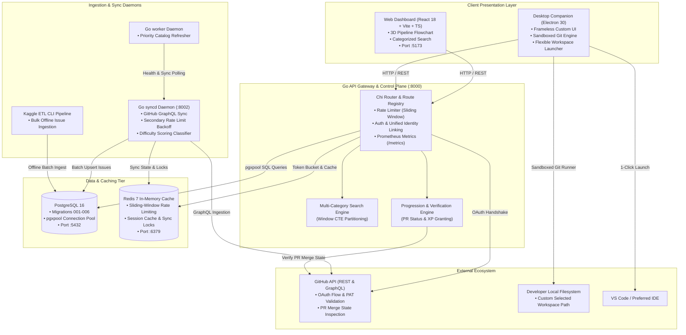
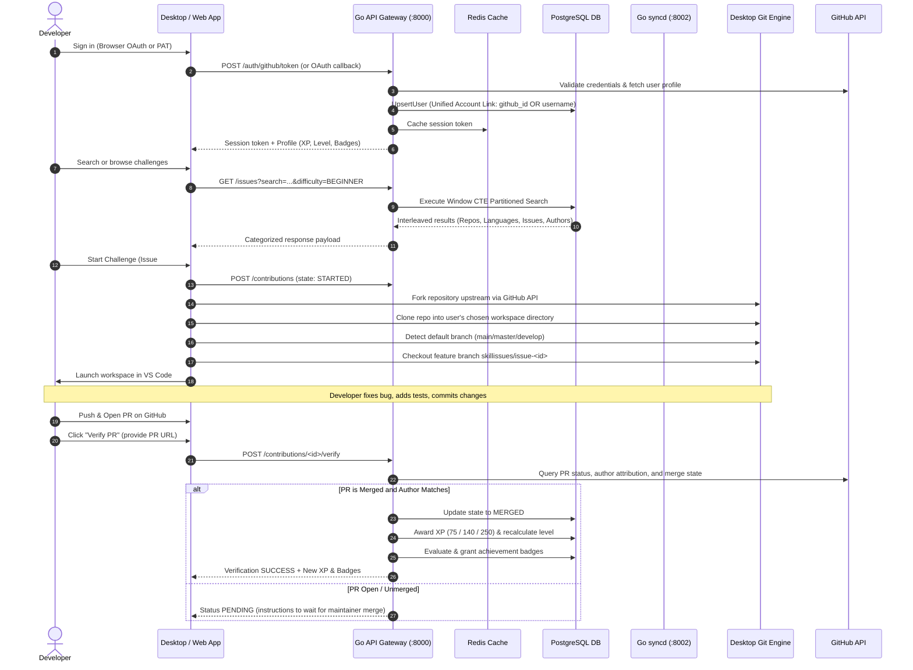

# SkillIssues — System Architecture & Technical Design

> **A comprehensive technical specification of the SkillIssues pure Go microservices architecture, data ingestion pipelines, deterministic recommendation engine, multi-category search heuristics, desktop sandboxed Git runner, and verified progression lifecycle.**

---

## 1. System Overview & Architectural Diagram

SkillIssues is an open-source developer-growth platform engineered to transform authentic GitHub issues into a structured, gamified learning questline. The system is architected as high-concurrency pure Go microservices backed by PostgreSQL 16 and Redis 7, with two client applications: a modern React 18 web dashboard and an Electron frameless native desktop companion.



---

## 2. The End-to-End Contribution Lifecycle

The contribution loop connects developer skill profiles to verified open-source pull requests:



---

## 3. Microservice Specifications

### 3.1 Go API Gateway (`backend/cmd/api/`)
- **Port**: `8000`
- **Runtime**: Distroless non-root container (`gcr.io/distroless/static-debian12:nonroot`)
- **Core Responsibilities**:
  - Exposes 28 REST endpoints adhering to the unified API contract.
  - Implements Redis-backed sliding-window rate limiting (180 req/hr unauthenticated, 1,000 req/hr authenticated).
  - Handles browser-based GitHub OAuth authorization handshakes and Personal Access Token (PAT) verification.
  - Executes case-insensitive unified account linking between PAT and OAuth users.
  - Serves multi-category search using PostgreSQL window functions.
  - Verifies GitHub PR merge states and computes XP/level/badge progression.
  - Exposes Prometheus telemetry on `/metrics` and health readiness on `/health`.

### 3.2 Go Sync Coordinator (`backend/cmd/syncd/`)
- **Port**: `8002`
- **Core Responsibilities**:
  - Communicates with GitHub's GraphQL API to discover and qualify open-source issues.
  - Implements concurrency-controlled worker pools with exponential backoff on GitHub secondary rate limits.
  - Parses issue text, extracts technology tags and required skills, and computes deterministic difficulty scores.
  - Maintains distributed sync locks in Redis to prevent concurrent ingestion races.

### 3.3 Go Priority Worker Daemon (`backend/cmd/worker/`)
- **Core Responsibilities**:
  - Periodically triggers priority catalog refreshes for actively worked challenges and tracked repositories.
  - Monitors `syncd` health and triggers automated ingestion cycles.

### 3.4 Standalone Offline Kaggle ETL CLI (`backend/cmd/kaggle_etl/`)
- **Core Responsibilities**:
  - Standalone binary for bulk importing large offline GitHub dataset archives (e.g. from Kaggle) into PostgreSQL.
  - Performs deduplication, metadata sanitization, and difficulty assignment offline without hitting GitHub API rate limits.

---

## 4. Database Schema & Data Models

PostgreSQL 16 serves as the persistent relational database, managed via incremental SQL migrations (`database/migrations/`):

### Schema Migration History
- `001_initial_schema`: Core entity definitions:
  - `users`: Developer accounts, GitHub IDs, usernames, avatars.
  - `user_profiles`: Bio, target level, preferred languages, demonstrated skills.
  - `repositories`: Tracked open-source repos, stars, language, default branch.
  - `issues`: Issue numbers, titles, bodies, difficulty scores, required skills.
  - `contributions`: Workspace tracking, branch names, PR URLs, lifecycle states.
  - `saved_issues`: Bookmark registry for developers saving challenges.
  - `user_badges`: Unlocked achievement badges and award timestamps.
- `002_add_author_to_issues`: Adds issue creator and author attribution indexing.
- `003_add_check_constraints`: Enforces valid contribution states (`STARTED`, `SUBMITTED`, `MERGED`, `CLOSED`) and score limits.
- `004_sync_state_and_audit_log`: Ingestion telemetry, sync timestamps, and audit logging.
- `005_allow_multiple_contributions_per_issue`: Permits re-attempts and multiple PR submissions per issue.
- `006_link_users_by_username_and_github_id`: Adds case-insensitive `lower(username)` unique index to support unified identity across PAT and OAuth.

---

## 5. Algorithmic Deep Dives

### 5.1 Difficulty Scoring Classifier
Every ingested issue is scored into a normalized difficulty tier:
$$\text{Score} = w_{\text{body}} \cdot f(\text{len}_{\text{body}}) + w_{\text{comments}} \cdot \ln(1 + C) + w_{\text{labels}} \cdot L + w_{\text{skills}} \cdot S$$

- **Difficulty Tiers & XP Rewards**:
  - `BEGINNER` (Score 0–35): **75 XP** (Contains `good first issue`, `beginner-friendly`, short reproducible bug).
  - `INTERMEDIATE` (Score 36–70): **140 XP** (Multi-file features, refactors, moderate discussions).
  - `ADVANCED` (Score 71–100): **250 XP** (Architectural overhauls, concurrency bugs, performance optimizations).

### 5.2 Multi-Category Interleaved Search & Ranking
To prevent a single category (like languages) from monopolizing search results, the query utilizes a Common Table Expression (CTE) partitioned by category:

```sql
WITH categorized AS (
    SELECT id, number, title, body, difficulty, repository, language, comments, url, author,
           match_category,
           ROW_NUMBER() OVER (
               PARTITION BY match_category
               ORDER BY
                   CASE WHEN match_category = 'Repository' AND lower(repository) = lower($1) THEN 0
                        WHEN match_category = 'Repository' AND lower(repository) LIKE lower($1) || '%' THEN 1
                        ELSE 2 END ASC,
                   difficulty_score DESC
           ) as cat_rank
    FROM issue_search_matches
)
SELECT * FROM categorized
WHERE cat_rank <= 15
ORDER BY cat_rank ASC, match_category ASC;
```

This guarantees balanced representation across **Repositories**, **Languages**, **Issues**, and **Authors**, while boosting official repositories like `golang/go` to rank #1.

### 5.3 Progression & Leveling Ladder
Levels are determined by cumulative verified XP earned through merged pull requests:

| Level | Title | Required XP | Unlocks |
| :---: | :--- | :---: | :--- |
| **1** | `Novice Contributor` | 0 XP | Beginner catalog access, workspace runner |
| **2** | `Junior Contributor` | 250 XP | Intermediate challenges, polyglot matching |
| **3** | `Open Source Contributor` | 750 XP | Advanced challenges, community spotlight |
| **4** | `Senior Contributor` | 1,750 XP | Architecture challenges, priority verification |
| **5** | `Staff Contributor` | 3,500+ XP | Master badges, mentor status |

---

## 6. Client Implementations

### 6.1 Native Desktop App (Electron 30)
- **Frameless Custom Interface**: Seamlessly integrated titlebar with window dragging and custom control buttons matching the platform's signature theme (`#f7f6fb` / `#241442`).
- **Sandboxed Git Runner**:
  - Custom workspace parent folder selector with persistence.
  - Dynamically detects default upstream branches (`main`, `master`, etc.).
  - Non-blocking clone progress bar designed to withstand high-volume repositories without buffer overflow.
  - 1-click VS Code launcher (`code .`).
- **Categorized Search & Discovery**:
  - Category tabs with live counts and collapsible accordions.
  - Difficulty sub-tabs and paginated feed controls.

### 6.2 Web Dashboard (React 18 + Vite + TypeScript)
- **Promotional 3D Pipeline Flowchart (`LandingPage.tsx`)**:
  - Interactive CSS 3D perspective viewport (`perspective: 1000px`) with smooth cursor tilt tracking (`rotateX` / `rotateY`).
  - 4 interconnected pipeline nodes with interactive step inspector showing live code schema, matching tags, terminal clone output, and XP reward previews.
- **Intelligent View Routing**:
  - Guests default to **Overview** (landing page).
  - Authenticated users default to **Challenges** (issue feed).
  - Clickable logo returns to **Overview**.
- **Issue Modal UX**:
  - Floating external Back button (`← Back to issues [Esc]`).
  - Backdrop click dismissal and `Esc` key listener.
  - Background page scroll lock and automatic scroll-position reset.
  - Interactive technology search chip picker for profile preferences.

---

## 7. Security, Caching & Observability

- **Unified Account Security**:
  - Case-insensitive `lower(username)` constraint prevents account squatting or dual-account creation across PAT and OAuth flows.
  - Session tokens cryptographically signed and stored in Redis with TTL expiration.
- **Sliding-Window Rate Limiting**:
  - Backed by Redis sorted sets (`ZADD` / `ZREMRANGEBYSCORE`).
  - Strict limits for unauthenticated visitors (180/hr), generous allowances for authenticated developers (1,000/hr).
  - System probes (`/health`, `/metrics`) exempted.
- **Prometheus Telemetry**:
  - Route execution histograms, active worker gauges, sync cycle counters, and cache hit metrics exposed on `/metrics`.
- **Container Hardening**:
  - Google Distroless non-root base images (`nonroot:nonroot`).
  - No shell, package manager, or unnecessary tools in production containers.
