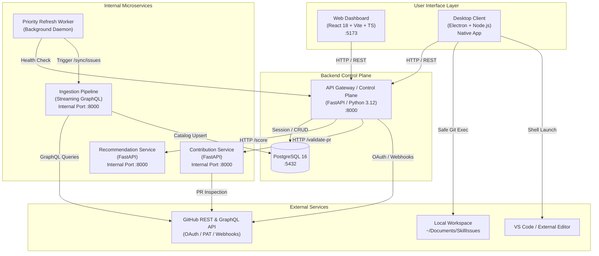
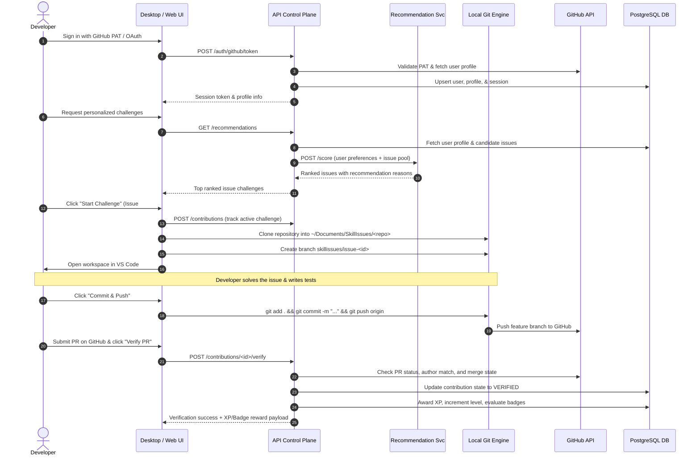
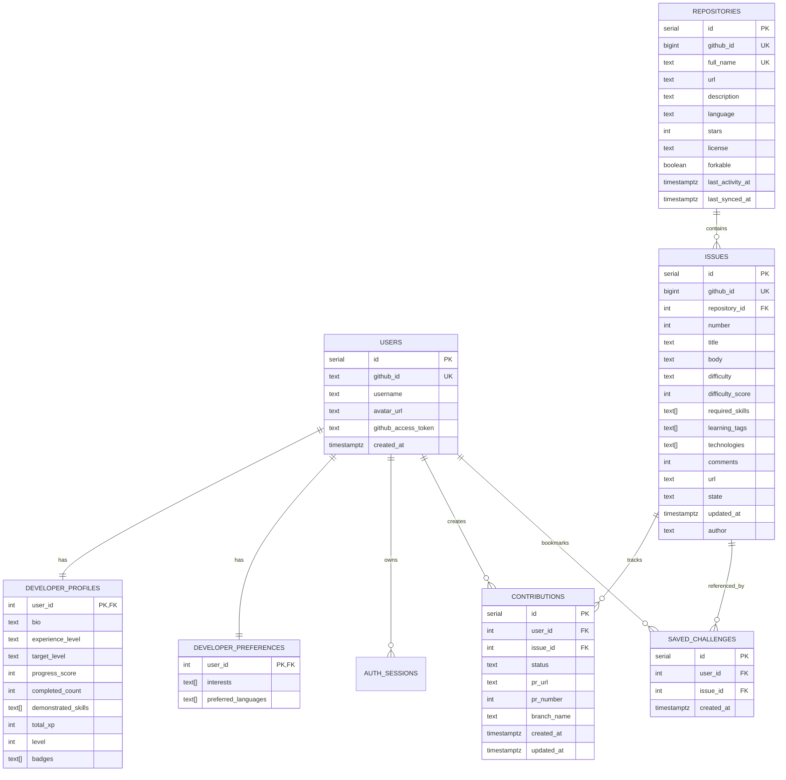

# SkillIssues — System Architecture & Technical Design

> **A comprehensive technical overview of the SkillIssues architecture, microservices control plane, data pipelines, recommendation algorithms, and security boundaries.**

---

## 1. System Overview & Architectural Diagram

SkillIssues bridges the gap between learning to code and contributing to real-world software engineering. The platform runs as a distributed control plane consisting of microservices, an event-driven background worker, a PostgreSQL relational store, a modern web dashboard (React + Vite), and an Electron native desktop client.

---

## 2. The Core Feedback Loop

The platform guides developers through an end-to-end contribution lifecycle:

---

## 3. Microservice Roles & Responsibilities

### 3.1. API Gateway / Control Plane (`services/api`)
- **Technology**: Python 3.12, FastAPI, Uvicorn, psycopg 3 (native connection pooling).
- **Core Responsibilities**:
  - **Authentication**: Supports GitHub OAuth with PKCE verification, GitHub Personal Access Token (PAT) authentication, and local development demo tokens.
  - **Session Management**: Issues secure SHA-256 digested session tokens stored in PostgreSQL with 7-day expiration.
  - **Profile Management**: Tracks user bio, target difficulty level (`BEGINNER`, `INTERMEDIATE`, `ADVANCED`), preferred languages, interests, and demonstrated skills.
  - **Issue Catalog Search**: Full-text and metadata filtering across repositories, languages, difficulty ratings, and required skills.
  - **Gamification Engine**: Calculates user level progression, awards XP based on issue difficulty scores, and unlocks achievement badges:
    - `First Blood 🩸`: First verified PR contribution.
    - `Bug Wrangler 🩹`: 3+ completed contributions.
    - `Polyglot 🧪`: Solved issues across multiple distinct programming languages.
    - `World Traveller 🗺️`: Solved issues across 3+ different GitHub repositories.
    - `Touch Grass 🌱`: Reached level 5 or completed 10+ contributions.

### 3.2. Recommendation Service (`services/recommendation`)
- **Technology**: Python 3.12, FastAPI.
- **Port**: `8000` (Internal Docker network only).
- **Algorithm**: Calculates a deterministic multi-factor match score for each candidate issue:
  $$\text{Score} = (\text{Skill Match} \times 2) + \text{Interest Match} + \text{Difficulty Proximity} + \text{Popularity Bonus}$$
  Where:
  - **Skill Match**: Count of user's demonstrated skills overlapping with issue required skills (weighted $\times 2$).
  - **Interest Match**: Count of user's declared interests overlapping with issue learning tags.
  - **Difficulty Proximity**: Target difficulty mapping (`BEGINNER`: 3, `INTERMEDIATE`: 5, `ADVANCED`: 7). Closeness score: $\max(0, 5 - |\text{difficulty\_score} - \text{target}|)$.
  - **Popularity Bonus**: Logarithmic star tier bonus: $\min(3, \lfloor \text{repository\_stars} / 25000 \rfloor + 1)$.
- **Output**: Issues sorted descending by recommendation score, accompanied by explanatory tags (`why_recommended`).

### 3.3. Contribution Service (`services/contribution`)
- **Technology**: Python 3.12, FastAPI, HTTPX.
- **Port**: `8000` (Internal Docker network only).
- **Core Responsibilities**:
  - Validates GitHub Pull Requests via the GitHub REST API (`GET /repos/{owner}/{repo}/pulls/{number}`).
  - Verifies that the pull request author's GitHub handle matches the authenticated user's GitHub username (case-folded comparison).
  - Inspects pull request state (`open`, `closed`) and boolean `merged` status to prevent false claims.

### 3.4. Ingestion Pipeline (`services/ingestion`)
- **Technology**: Python 3.12, GraphQL client, ijson streaming parser, psycopg.
- **Core Responsibilities**:
  - Streams repositories and open issues from GitHub via GraphQL paginated queries (`RepositoryIssues`).
  - Evaluates issue eligibility: excludes pull requests, automated bot issues, and duplicates.
  - Computes algorithmic difficulty scores (1–10) based on body length, comment volume, code block complexity, and label indicators (`good first issue`, `help wanted`, `easy`, `complex`).
  - Infers required skills and learning tags using keyword and technology extraction heuristics.

### 3.5. Priority Refresh Worker (`services/worker`)
- **Technology**: Python 3.12, HTTPX.
- **Core Responsibilities**:
  - Runs as an independent background daemon.
  - Periodically triggers the ingestion service's `/sync/issues` endpoint (default interval: 900 seconds / 15 minutes) to ensure issue statuses, comment counts, and new open issues remain fresh in the database without overwhelming GitHub rate limits.

---

## 4. Database Relational Model

PostgreSQL 16 serves as the single source of truth for user states, repository metadata, and contributions:

---

## 5. Electron Desktop Security & Architecture

The Electron desktop client acts as the native companion tool for local Git operations. Because it operates on the developer's local machine, strict security controls are enforced:

1. **Workspace Sandboxing**:
   - All repository clones and Git operations are strictly confined to a fixed root directory: `Documents/SkillIssues/<owner>/<repo>`.
   - The path verification helper (`isSafeWorkspace`) validates canonical paths and rejects path traversal attempts (`..`) or paths outside the designated directory.
2. **Sanitized Git Commands**:
   - Git operations execute via `execFileAsync("git", args)` with explicitly bounded arguments rather than executing raw shell strings.
   - Branch names are validated against `/^[A-Za-z0-9][A-Za-z0-9._/#-]{0,80}$/` to prevent shell injection or invalid git ref creation.
3. **Restricted IPC Bridge**:
   - `preload.js` exposes only 14 explicit methods via `contextBridge.exposeInMainWorld("skillIssuesDesktop", ...)`.
   - Node.js APIs (`fs`, `child_process`, `electron`) are completely inaccessible to the renderer window.
   - Backend credentials never enter the renderer DOM.
4. **Content Security Policy (CSP)**:
   - A restrictive CSP is enforced across all renderer frames: external scripts are forbidden, and external navigation is restricted strictly to GitHub URLs opened via `shell.openExternal`.
5. **Single-Instance Locking**:
   - Uses `app.requestSingleInstanceLock()` to prevent concurrent conflicting instances, with protocol deep linking (`skillissues://`) handled gracefully.
