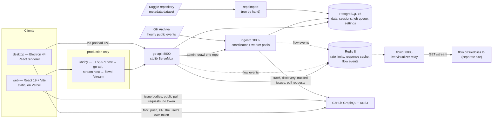

# Architecture

How SkillIssues is put together, as of the code in this repository. For the rules contributors
must follow, see [CLAUDE.md](CLAUDE.md).

## 1. Components



| Binary (`backend/cmd/`) | Role |
|---|---|
| `api` | The HTTP API ([route list](docs/api.md)). Go standard-library `http.ServeMux` with method patterns; no third-party router. |
| `ingestd` | GitHub crawler. One coordinator loop and four worker pools (Initial, Deep Diver, Discovery, Archive), plus the tracked-issue check, the pull request/XP pass, issue body fetches and the catalog's periodic jobs. Its state is in Postgres only; Redis carries nothing but its flow events. |
| `flowd` | Relay for the public live visualizer. Subscribes to the flow events go-api and ingestd publish to Redis, caps the labelled ones per second, counts the rest as link density, and serves them at `GET /stream` (SSE or ndjson). Signed-in traffic arrives already redacted to symbols. |
| `migrate` | Applies the embedded goose migrations and exits. Compose runs it before anything else starts. |
| `repoimport` | Streams the ~4.2M-record Kaggle dataset, stores the ~288k eligible repositories. Resumable, idempotent. |
| `healthcheck` | Tiny binary used as the containers' Docker `HEALTHCHECK`. |

The schema lives only in `backend/internal/migrate/migrations/`, embedded into the binaries.

## 2. Ingestion

```text
Kaggle dataset ──repoimport──▶ repositories (eligible only)
                                   │ coordinator cycle (ingest.claim_interval_seconds)
                                   ▼
                     Initial: first page of open issues
                                   │ hasNextPage?
                                   ▼
                     Deep Diver: next page from stored cursor, until done
                                   │
                     Freshness: once the last sync is stale, fetch what changed since the
                     last completed pass (open issues updated, issues closed)

Discovery Sweeper ──GitHub repository search──▶ repositories it finds (same eligibility)
GH Archive reader ──hourly event files──▶ issues of stored repositories (newer only);
                                          unknown repositories → candidates → looked up
```

- **Every eligible repository is crawled.** There is no ranking or priority anywhere in the
  crawl path: jobs are FIFO on `next_retry_at`. Eligibility (`ingest.eligibility.*`) is abuse
  control — anyone can open issues on a throwaway repo — not a quality judgement.
- **Postgres is the queue.** `ingest_jobs` rows are claimed with `FOR UPDATE SKIP LOCKED` and a
  lease. A page's issues, its cursor and `last_synced_at` commit in one transaction, so a crash
  can only cause a page to be fetched twice, never skipped. Expired leases are reclaimed every
  `ingest.lease_reclaim_interval_seconds`, and each job write is fenced on the lease owner, so a stalled worker that wakes up
  after its job was reclaimed has its write rejected rather than overwriting the cursor.
- **One shared GitHub budget.** Both lanes (`crawler`, `interactive`) record GitHub's rate-limit
  telemetry in `github_budget` and are read as one counter. The crawler stops while
  `ingest.interactive_reserve_percent` of the limit is left; work a person is waiting on
  (`interactive`) spends down to `ingest.rate_limit_floor`.
- **Failures are isolated.** `NOT_FOUND` marks the repository unavailable;
  `RESOURCE_LIMITS_EXCEEDED` halves the page size and retries down to 1; rate limits pause the
  lane for `ingest.rate_limit_pause_seconds`; other errors back off exponentially and land in `failed` after
  `ingest.max_attempts`.
- **Disk guardrails.** `ingest.max_pages_per_repo` caps how deep one repository goes;
  `ingest.max_db_size_mb` pauses new work when the database grows past it.

Design rationale, the Discovery Sweeper and the GH Archive reader in full: [docs/ingestion-architecture.md](docs/ingestion-architecture.md).

## 3. Data model (main tables)

| Table | Holds |
|---|---|
| `repositories` | Imported metadata: stars, language, topics, pushed date, `is_eligible`, `last_synced_at` |
| `issues` | One row per `(repository_id, number)`; raw GitHub `labels` kept as-is; `updated_at` is GitHub's |
| `users`, `auth_sessions` | Accounts keyed by GitHub id (no token columns); sessions stored as SHA-256 hashes of the session token |
| `developer_profiles`, `developer_preferences` | Bio, experience and target level; languages, interests |
| `saved_issues` | Bookmarks |
| `ingest_jobs`, `github_budget`, `import_skipped` | Crawl queue, shared rate-limit budget, import skip ledger |
| `settings`, `settings_audit` | Live configuration and every change to it |
| `webhook_events` | GitHub delivery ids, for deduplication |
| `discovery_sweeps`, `discovery_windows`, `archive_hours`, `repo_candidates` | The Discovery Sweeper's and the GH Archive reader's leased queues |
| `notifications` | Written by triggers: an issue you saved closed, a merge paid XP |
| `pull_requests`, `xp_events` | Tracked public pull requests and the append-only XP ledger |
| `issue_claims`, `learning_paths`, `reports`, `user_themes` | Claims, learning paths, reports, themes |
| `catalog_stats`, `catalog_facets`, `issue_bodies` | Live counts, filter values, the bounded body cache |

Every table and column: [docs/database.md](docs/database.md).

## 4. How the product logic works

**Difficulty** (`internal/sync/classify.go`) comes from labels only. Beginner-style labels
(`good first issue`, `difficulty/easy`, `size/xs`, `effort/low`, …) → `BEGINNER`; medium →
`INTERMEDIATE`; hard/expert/large → `ADVANCED`. Anything else is `UNCLASSIFIED` with a NULL
score. There is no text or comment-count heuristic.

**Search** (`internal/issue/search_categories.go`). Three categories, each its own indexed query,
run concurrently: Repository (trigram on the name; skipped under 3 characters), Title (Postgres
full-text on title and labels, a bounded sample ordered by stars) and Language (the main language,
or one of its tech). Go interleaves them rank by rank, each issue once, so one category cannot
flood the page and every page is a slice of one list. Authors are not searched.

**For you** (`internal/issue/foryou.go`), the default feed: repositories in a daily shuffled order,
each one's best open issue, every chunk ordered by a weighted random draw on Fit × Doable × Need.
Stars never enter it.

**Recommendations** (`internal/recommendation/score.go`):
`15 × language match + 8 × technology match + 2 × shared skills + shared interests +
max(0, 5 − |difficulty − target|)`, over a bounded pool read off the shuffled feed. Stars never
enter it; ties keep the feed's order.

## 5. Auth and credentials

- **The server holds no user GitHub token.** Sign-in uses the **Login app**, a no-scope OAuth
  App: the server reads the numeric id, login and avatar and discards the token. The browser
  flow is bound to the browser that began it by a `__Host-oauth_state` cookie; the desktop app
  runs a device flow on the same app and posts its token once to `POST /auth/github/device`,
  which GitHub confirms was issued to the Login app.
- **Accounts** are identified by GitHub id only. A username is display data and is never used to
  find an account; if another row holds it, that row's username is cleared.
- **Sessions** live in Postgres, so they survive a Redis outage. The cookie is `HttpOnly`;
  always `SameSite=Lax`, and `Secure` when `FRONTEND_URL` is `https://`. A session ends on
  logout, expiry, "log out everywhere" or purge — revoking the Login app on GitHub does not end
  one, because there is no token to invalidate.
- **CSRF**: cross-site mutations are refused (`http.CrossOriginProtection`), and a request that
  carries the session cookie must send `Content-Type: application/json`. Bearer requests are
  exempt.
- **Whose token does what:** crawling uses the server credential (GitHub App installation token,
  or `GITHUB_TOKEN`). Forks, pushes, pull requests and issue-body reads are the desktop client's,
  using a token that never leaves the user's machine. The server cannot act on a user's GitHub
  account.
- **Webhooks** are HMAC-SHA256 verified. **Admin** routes take a bearer token compared in
  constant time.

**Database access.** Migrations run as the database owner. `go-api` and `ingestd` connect as
`skillissues_api` and `skillissues_ingest`, which hold per-table DML grants and nothing else, so
a compromised service cannot drop or alter the schema or run commands on the host. `flowd`
connects as `skillissues_flow`, which can read `settings` and nothing else.

## 6. Rate limiting and caching

A Redis counter per signed-in user or per client IP (`X-Forwarded-For` honoured only from
`TRUSTED_PROXIES`). Defaults are 180 requests per window signed out and 1,000 signed in, window
3600s — all live settings. The window is fixed: it starts at a client's first request and the
count resets one window later, however busy the client is. `/health`, `/health/detail` and `/metrics` are exempt;
login is not. Redis also caches the default catalog page, unauthenticated searches,
recommendations and For you's drawn chunks, and counts how often each issue is served. If Redis is down, limiting fails open and caching is skipped — nothing else
depends on it. Failing open is fast: each call has a deadline (`api.cache.redis_timeout_ms`), and
after a failure the API stops calling Redis, letting one call through every
`api.cache.redis_retry_seconds` to check whether it is back. Each failed Redis call counts in
`cache_errors_total{op}`, each skipped one in `cache_skipped_total{op}`, and the API logs once when
Redis becomes unreachable and once when it recovers.

## 7. Configuration

Three layers: bootstrap env (`DATABASE_URL`, `REDIS_URL`, `PORT`, `FRONTEND_URL`), secrets in
env, and **everything operational in the `settings` table**, changeable live and validated by a
database trigger. Full list: [docs/settings.md](docs/settings.md).

## 8. Observability

Both Go services serve Prometheus metrics at `/metrics`: HTTP traffic and latency by route
pattern, outbound GitHub calls, ingest job outcomes, queue depth, repository coverage, the GitHub
budget per lane, worker pools, connection pools, and Go runtime stats. The compose stacks run
Prometheus, Grafana (six provisioned dashboards), node-exporter, cAdvisor and Postgres/Redis
exporters. Product panels query Postgres as `metrics_ro`, a read-only role that cannot see session tokens
or OAuth state.

## 9. Clients

Both clients use the npm workspace package `@skillissues/client` (typed client, `ApiError` with
status and problems, a pluggable transport: fetch in the browser, IPC on the desktop).
`@skillissues/theme` checks and applies user themes, and `@skillissues/markdown` (markdown-it +
DOMPurify) is the only way issue bodies, which are attacker-controlled, may be rendered.

**Web** (`web/`, on Vercel): React 19. The landing, docs and legal pages are prerendered; `/app` is
the signed-in app: Explore, search, the issue page (its description read from GitHub in the
browser), saved issues and notifications, claims, the profile with XP, learning paths, settings
and the theme editor, and moderation for moderators.

**Desktop** (`desktop/`, electron-vite): the page runs with `contextIsolation`, `sandbox` and no
Node, behind a CSP that lets it reach no network itself. It talks to the main process only through
the typed contract in `src/shared/contract.ts`; the main process proxies an allowlist of API calls
with the session, opens only GitHub and site links, and refuses calls from any frame but its own
page. Sign-in is a no-scope GitHub device flow whose token is posted once to the API and dropped;
pushing takes a second, `public_repo` device flow whose token stays on the machine (in the OS
keychain, or memory only where there is none). Workspace flow: fork with that token, clone the fork
into the workspace folder (default `~/Documents/SkillIssues`; every path is checked to stay inside
it), `upstream` at the original, a branch per issue, commit and push, open the pull request, open
VS Code. Git runs as async child processes; the token reaches it through the environment, never the
command line. Cloned code is never executed.
